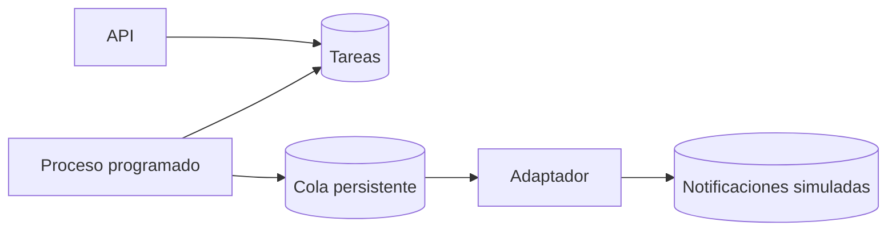

# Arquitectura de FlowPilot

## Prevención de duplicados

La combinación del identificador de tarea y la etapa del recordatorio es única en la cola persistente (outbox). El destino local también registra una clave única por evento, de modo que repetir una entrega no crea otro registro.

## Reintentos y cancelación

El motor vuelve a intentar los eventos fallidos después de una espera exponencial. Al alcanzar tres intentos los marca como fallidos. Completar una tarea cancela sus eventos pendientes, pero no elimina los que ya fueron entregados.

El procesamiento se realiza mediante transacciones SQLite que serializan la entrega. Este diseño es suficiente para una demostración local; un entorno distribuido requeriría una cola externa, control de concurrencia y garantías de idempotencia del proveedor de notificaciones.

Las fechas se comparan en UTC. Los dos recordatorios se calculan respecto a la fecha de vencimiento de la tarea, no respecto a la fecha de entrega del primero. Si una tarea se registra con más de siete días de retraso, ambos pueden generarse en la misma ejecución.

## Límites

La API no tiene autenticación. Los envíos son simulados y la información se conserva localmente. No introducir datos personales o institucionales.

La generación de recordatorios adquiere una reserva de escritura antes de consultar las tareas, de modo que varias ejecuciones locales no creen eventos simultáneamente a partir de un estado desactualizado. Se incluyen pruebas de concurrencia, tareas futuras y cancelación previa a la entrega.
