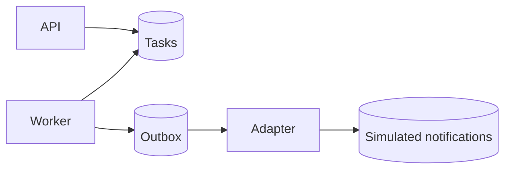

# Design

A unique task/stage constraint prevents duplicated events. The local destination independently deduplicates event IDs, including retries after a crash. The worker serializes dispatch with SQLite; real distributed execution needs a queue, leases and provider idempotency. Retries use bounded exponential delay and a terminal failed state. The example schedules reminders on the due date and seven days later; completing a task cancels pending events. The API is deliberately local-only and has no authentication. No email is sent.
